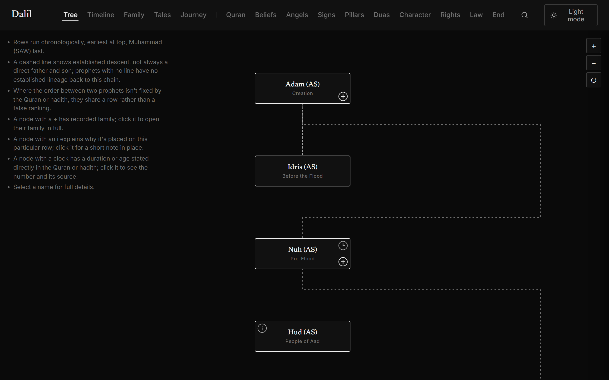
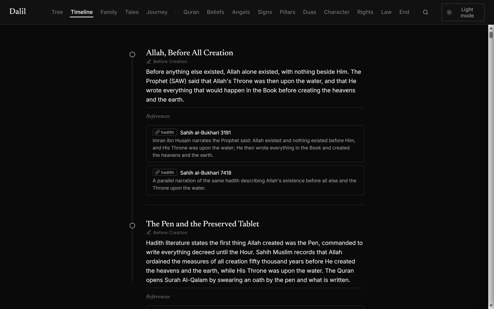
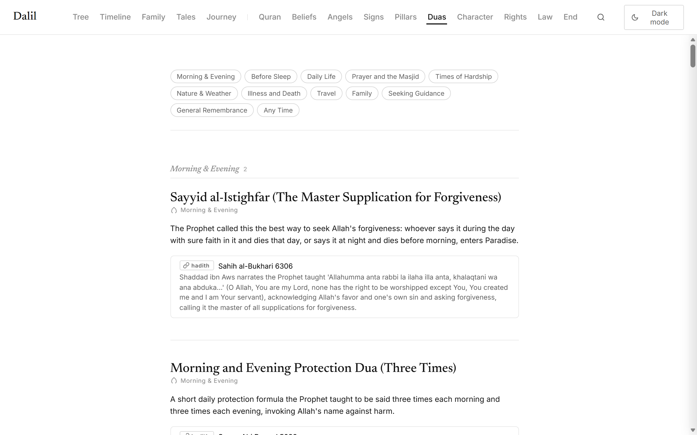

# Dalil

Dalil (Arabic: دليل, "evidence" or "guide") is a reference site on Islamic history, belief and practice, built on one rule: **every claim is backed by a real, verifiable citation to the Quran or an authentic hadith.** Nothing is sourced to folklore, weak narrations or popular tradition without saying so plainly. Where a name, date or detail is commonly repeated but isn't actually in the text, the site leaves it out or says outright that it isn't backed.

**[Open the live site →](https://ibrahimahtsham.github.io/dalil/)**




| Timeline | Duas (light theme) |
| --- | --- |
|  |  |

## Views

- **Tree:** a family diagram of the 25 prophets named in the Quran, with pan and zoom, plus badges for recorded family, why a prophet sits on a given row, and dates the text states outright.
- **Timeline:** dated history in order, from creation through the death of the Prophet (SAW).
- **Family:** each prophet's recorded family members, each with its own sourcing note.
- **Tales:** Quranic accounts beyond the prophets (Ashab al-Kahf, Dhul-Qarnayn, Qarun and others).
- **Journey:** the soul's path from the primordial covenant through the afterlife, as one flowchart linking into already-cited entries.
- **Ten subject tabs:** Quran, Beliefs, Angels, Signs, Pillars, Duas, Character, Rights, Law and End Times. Each is a scannable index of real citations rather than a copy of their content, and long tabs are grouped into sections with jump links.

Site-wide search (press `/` or `Ctrl/Cmd+K`) covers every field of every entry, and each entry has an "Also in" row linking to the other views it appears in.

## Editorial rules

- Quran and authentic hadith only. A popular name, date or detail without real textual backing is omitted or clearly flagged as unconfirmed, never presented as fact.
- No em dashes anywhere in the codebase.
- Strict grayscale: no colour anywhere, in either theme.
- The site title stays simply "Dalil".

## How it's built

No build step, no framework, no dependencies: plain HTML, CSS and JS served as static files.

```
index.html          Single-page shell; every view lives inside it
data/timeline.json  The single source of truth: every entry on the site
js/main.js          Entry point: routing, cross-linking, search
js/components/      One renderer per view (tree, timeline, family, tales,
                    journey, topic pages, search, reference lists, icons)
js/lib/panzoom.js   Small pan/zoom used by the Tree view
css/                One stylesheet per view, plus variables.css (the whole,
                    strictly grayscale colour system) and components.css
```

### Data model

Every entry in `data/timeline.json` has the same shape:

```json
{
  "id": "unique-slug",
  "name": "Display Name",
  "category": "prophet | event | tale | angel | jinn | cosmology | quran |
               sign | belief | duty | dua | character | right | law | endtimes",
  "era": "A period label, or a group label on topic pages",
  "summary": "What the entry says, in plain prose",
  "references": [
    { "type": "quran" | "hadith", "label": "Surah X:Y or Book N", "url": "...", "gist": "one sentence on what that specific citation says" }
  ]
}
```

Some categories carry more. `prophet` entries can have `family`, `lineage`, `placementNote` (why a prophet sits where it does in the tree) and `provenDates` (a duration or age the text states outright, like Nuh's 950 years). `tale` and some `prophet` entries have `tale.chapters` for a longer narrative split into cited sections.

`category` drives everything: which of the fifteen tabs an entry appears on, whether it shows in the Tree (prophets only) or the Timeline (dated events only), and which other views it cross-links to.

## Run it locally

```
python -m http.server
```

Or open `index.html` with any static file server, such as the Live Server extension. There is nothing to install or compile.
